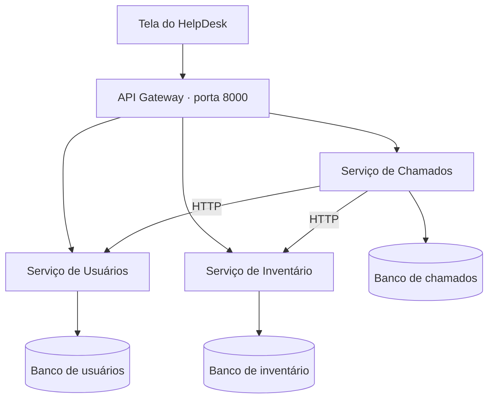
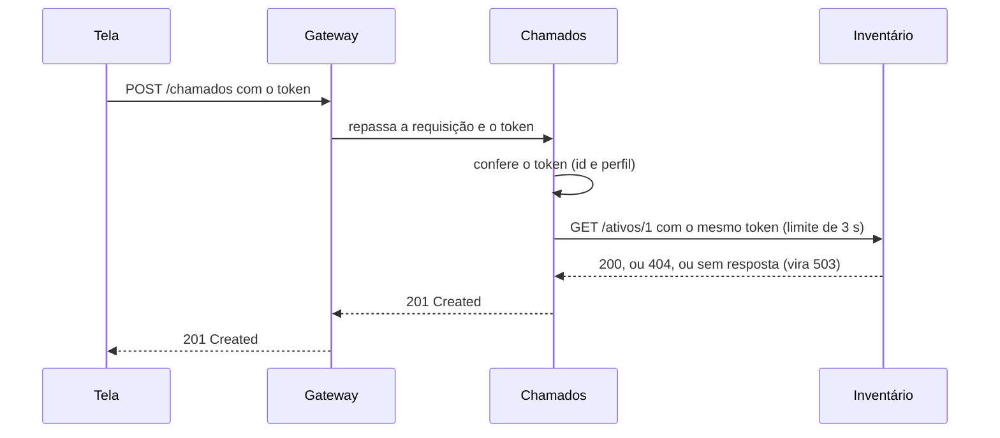

# HelpDesk TI · versão em microsserviços

> 🎥 **Vídeo de demonstração:** _(o link será colocado aqui)_

Sistema de chamados de TI (no estilo de um GLPI simplificado), feito em **Python + FastAPI**.
Esta é a versão em **microsserviços** do desafio de Arquitetura de Software ([DESAFIO.md](DESAFIO.md)):
o monólito original foi dividido em **três serviços independentes**, cada um com o seu banco,
e um **API Gateway** que é o único ponto de entrada.

**Aluno:** Pedro ([@pedromarcs](https://github.com/pedromarcs))

O monólito original continua no histórico do Git, marcado com a tag
[`monolito-original`](https://github.com/pedromarcs/helpdesk-microsservicos-pedro/tree/monolito-original).

## O que o sistema faz

- **Login** com e-mail e senha; cada pessoa vê e faz só o que o seu perfil permite.
- Cadastra **usuários** e **equipamentos** (inventário de TI).
- **Abre chamados** com prioridade e calcula o prazo de atendimento (SLA): crítica 4 h, alta 8 h, média 24 h, baixa 72 h.
- **Atribui** chamados a técnicos, controla o **status** (com transições válidas) e aceita **comentários**.
- Registra **notificações** quando um chamado é aberto, atribuído ou resolvido.
- Mostra um **painel** com totais por status e chamados atrasados.

## Arquitetura



O gateway também serve a tela, então o endereço do sistema continua o mesmo: `http://localhost:8000`.
**Só o gateway publica porta.** Os serviços e os bancos ficam dentro da rede do Docker.

| Serviço | Pasta | Responsabilidade | Banco (volume próprio) |
|---|---|---|---|
| **Gateway** | `gateway/` | Serve a tela e encaminha cada rota ao serviço dono dela | nenhum |
| **Usuários** | `servico-usuarios/` | Cadastro de usuários, **login** e geração do token | `usuarios.db` |
| **Inventário** | `servico-inventario/` | Equipamentos de TI | `inventario.db` |
| **Chamados** | `servico-chamados/` | Chamados, comentários, SLA, painel e notificações | `chamados.db` |

Roteamento do gateway:

| Rota | Serviço |
|---|---|
| `/auth/*`, `/usuarios*` | Usuários |
| `/ativos*` | Inventário |
| `/chamados*`, `/notificacoes*` | Chamados |
| `/`, `/app.js`, `/estilo.css` | O próprio gateway (a tela) |
| `/saude` | O próprio gateway (mostra quais serviços estão no ar) |

### Como uma requisição passa

Exemplo: abrir um chamado com equipamento.



## Como rodar

Requisito: **Docker** (com Docker Compose).

```powershell
# 1) Copie o arquivo de configuração
Copy-Item .env.example .env      # Linux e Mac: cp .env.example .env

# 2) Suba tudo (serviços, bancos e gateway)
docker compose up --build
```

Depois abra **http://localhost:8000**.

Se o `.env` não existir, o Docker avisa que falta o `JWT_SEGREDO` (ele é obrigatório).
Para ver o estado dos contêineres: `docker compose ps`. Para apagar tudo, inclusive os bancos: `docker compose down -v`.

> O `/docs` (Swagger) dos serviços não é exposto pelo gateway, de propósito: só o gateway tem porta aberta.

### Contas de acesso

Não é preciso criar conta: o sistema já começa com estes usuários. Todos usam a senha **`Helpdesk2026`**
(pode ser trocada com `SENHA_EXEMPLO` no `.env`).

| E-mail | Perfil | O que pode fazer |
|---|---|---|
| `admin@empresa.com` | Administrador | Tudo, inclusive cadastrar usuários |
| `carla@empresa.com` | Técnica | Ver todos os chamados, atribuir, resolver e cadastrar equipamentos |
| `diego@empresa.com` | Técnico | O mesmo que a Carla |
| `ana@empresa.com` | Solicitante | Abrir chamados e ver só os próprios |
| `bruno@empresa.com` | Solicitante | O mesmo que a Ana |

Dicas: para o fluxo completo (abrir, atribuir, resolver e fechar), entre como **Carla**.
Para testar as permissões, entre como **Ana**: ela não vê os chamados do Bruno.

> Estas contas têm senha conhecida e servem só para aula. Em produção, use `DADOS_EXEMPLO=0`.

### Configuração (`.env`)

| Variável | Para que serve |
|---|---|
| `JWT_SEGREDO` | Segredo que assina e confere os tokens. **O mesmo valor em todos os serviços.** Mínimo de 32 caracteres. |
| `TOKEN_MINUTOS` | Validade do login (padrão 60). |
| `DADOS_EXEMPLO` | `1` cria usuários, equipamentos e chamados de exemplo (só na primeira vez, com o banco vazio). |
| `SENHA_EXEMPLO` | Senha dos usuários de exemplo. |
| `DOCS` | `0` desliga o `/docs` dos serviços. |

O `.env` nunca vai para o GitHub (está no `.gitignore`). O `.env.example` traz um segredo **só para aula**.

## Decisões que tomei

**1. O token carrega o `id` e o `perfil`.** No monólito, cada requisição consultava o banco de usuários.
Agora o Inventário e o Chamados não podem ler esse banco, então confiam no que está dentro do token
(assinado com o `JWT_SEGREDO`). Assim eles autorizam sem chamar o serviço de Usuários a cada requisição.
O preço: se o perfil de alguém mudar, o token antigo continua valendo até expirar (60 minutos).

**2. Quem cria o token é só o Usuários; todos conferem.** Cada serviço confere a assinatura, o emissor,
a validade e o perfil. Tokens falsos, vencidos, sem perfil ou com perfil inventado são recusados (401).

**3. O gateway não confere o token, só o repassa.** Assim, cada serviço continua protegido mesmo se alguém
conseguisse falar com ele direto, e o gateway nem precisa conhecer o `JWT_SEGREDO`.

**4. O Chamados repassa o token do usuário** (cabeçalho `Authorization`) ao chamar Usuários e Inventário.
O outro serviço autoriza do mesmo jeito que autorizaria uma chamada vinda da tela.

**5. Tempo limite e erro claro.** Toda chamada entre serviços tem `timeout` de 3 segundos.
Se o serviço estiver fora do ar, demorar demais ou der erro inesperado, o Chamados responde **503** com uma
mensagem clara e **não grava nada pela metade**. Quando o outro serviço responde 404 ou 422, o Chamados
devolve o mesmo erro que o monólito devolvia, então a tela se comporta igual.

**6. Sem chave estrangeira entre serviços.** `solicitante_id`, `tecnico_id`, `ativo_id` e `autor_id`
viraram números simples. Quem garante que o técnico e o equipamento existem é a chamada HTTP, na hora de gravar.

**7. Cada serviço tem uma cópia do código de conferir o token.** É código repetido de propósito: assim
cada serviço continua independente (pode ser publicado, versionado e testado sozinho).

**8. As notificações ficaram dentro do serviço de Chamados.** A tela chama `GET /notificacoes`, então a rota
precisava continuar existindo, e o módulo já dependia só do Chamados. Os pontos que virariam eventos
estão marcados com `# bônus: vira evento` em `servico-chamados/app/chamados/servico.py`.

**9. Dados de exemplo sem chamada de rede.** O serviço de Chamados cria os seus chamados de exemplo direto
no próprio banco, sem chamar os outros serviços (que podem ainda estar subindo). Os ids de exemplo são fixos
(Ana = 2, Bruno = 3, Carla = 4; equipamentos 1 e 2).

**10. Segredo obrigatório.** Se o `JWT_SEGREDO` faltar ou for curto, o serviço **se recusa a subir**.
No monólito, um segredo aleatório era sorteado a cada início, o que quebraria o login entre serviços.

### O que acontece quando algo cai

| Situação | Resultado |
|---|---|
| Inventário fora do ar e abrir chamado **com** equipamento | **503** com mensagem clara; nada é gravado |
| Inventário fora do ar e abrir chamado **sem** equipamento | Funciona normalmente |
| Usuários fora do ar e atribuir chamado | **503**; o chamado continua como estava |
| Usuários fora do ar, para quem já está logado | Tudo continua (os outros serviços só conferem o token) |
| Usuários fora do ar, tentando entrar | **503** no login |
| Um serviço não responde no tempo | Chamados: 503 após 3 s. Gateway: **504** após 10 s |
| Qualquer serviço fora do ar | O gateway devolve **503** para as rotas dele; as demais continuam |

Dá para ver o estado de todos em `GET /saude` (o gateway consulta o `/saude` de cada serviço e mostra `ok` ou `fora do ar`).

### O que ficou melhor e o que ficou mais difícil

**Melhor**
- Cada serviço pode ser publicado, testado e escalado sozinho.
- Uma falha fica isolada: com o Inventário parado, usuários e chamados continuam funcionando.
- Cada parte tem o seu banco e, no futuro, poderia ter o seu time.

**Mais difícil**
- Agora existe **rede no meio**: tempo limite, erros parciais e mensagens claras viraram parte do código.
- **Sem integridade garantida pelo banco** entre serviços: se um equipamento for apagado depois, o chamado fica com um `ativo_id` que não existe mais.
- **Mais coisas para subir e configurar** (4 contêineres, segredo compartilhado, variáveis).
- **Código repetido** (conferência do token) e **perfil desatualizado** até o token expirar.
- Testar exige **simular** os outros serviços (nos testes do Chamados há um "Usuários e Inventário de mentira").

## Testes

São **89 testes**, divididos por serviço, incluindo testes de segurança (login, bloqueio por tentativas,
tokens falsos e vencidos, permissões por perfil, campos extras, limites de tamanho, cabeçalhos):

| Serviço | Testes | Destaques |
|---|---|---|
| Usuários | 22 | login, bloqueio, hash da senha, contrato do token |
| Inventário | 20 | tokens e perfis, permissões, validação |
| Chamados | 34 | regras do chamado, **repasse do token, timeout e falhas** |
| Gateway | 13 | roteamento, 503 e 504, repasse do token, tela |

Rodam sozinhos no **GitHub Actions** a cada envio (um job por serviço), junto com o `pip-audit`.
Para rodar na sua máquina, sem precisar de Python, use um contêiner descartável (exemplo para o Chamados, no PowerShell):

```powershell
docker run --rm -v "${PWD}\servico-chamados:/work" -w /work python:3.12-slim sh -c "pip install -q -r requirements.txt pytest==9.2.0 httpx==0.28.1 && pytest -q -p no:cacheprovider"
```

Com Python 3.11 ou mais novo instalado: entre na pasta do serviço, rode `pip install -r requirements-dev.txt` e depois `pytest -q`.

## Segurança

Veja o que está protegido e o que fazer antes de usar em produção em [SECURITY.md](SECURITY.md).
Resumo do que a versão em microsserviços mantém: token conferido em **todos** os serviços, permissões por perfil,
token repassado nas chamadas entre serviços, **só o gateway exposto**, segredo fora do código (`.env`),
contêineres sem privilégios (usuário comum, sistema de arquivos somente leitura, sem capacidades extras).

## Rotas principais

Todas exigem login, exceto `/auth/login` e `/saude`.

| Método | Rota | O que faz | Serviço | Quem pode |
|---|---|---|---|---|
| POST | `/auth/login` | Entra e recebe o token | Usuários | Todos |
| GET | `/auth/eu` | Dados de quem está logado | Usuários | Logado |
| POST | `/usuarios` | Cria usuário | Usuários | Admin |
| GET | `/usuarios` | Lista usuários (sem e-mail) | Usuários | Logado |
| GET | `/usuarios/{id}` | Dados públicos de um usuário (id, nome, perfil) | Usuários | Logado |
| POST / GET | `/ativos` | Cria e lista equipamentos | Inventário | Técnico e admin / logado |
| GET | `/ativos/{id}` | Busca um equipamento | Inventário | Logado |
| POST | `/chamados` | Abre chamado em nome de quem está logado | Chamados | Logado |
| GET | `/chamados` | Lista chamados | Chamados | Logado (solicitante vê só os seus) |
| GET | `/chamados/painel` | Totais por status e atrasados | Chamados | Logado |
| PATCH | `/chamados/{id}/atribuir` | Atribui a um técnico | Chamados | Técnico e admin |
| PATCH | `/chamados/{id}/status` | Muda o status | Chamados | Técnico e admin (solicitante: fechar ou reabrir) |
| POST | `/chamados/{id}/comentarios` | Comenta no chamado | Chamados | Envolvidos |
| GET | `/notificacoes` | Minhas notificações | Chamados | Logado |
| GET | `/saude` | Quais serviços estão no ar | Gateway | Todos |

### Perfis e permissões

| Ação | Solicitante | Técnico | Administrador |
|---|:-:|:-:|:-:|
| Abrir chamado | ✅ | ✅ | ✅ |
| Ver chamados | só os seus | todos | todos |
| Comentar | nos seus | todos | todos |
| Atribuir e resolver | ❌ | ✅ | ✅ |
| Fechar ou reabrir um chamado resolvido | os seus | ✅ | ✅ |
| Cadastrar equipamentos | ❌ | ✅ | ✅ |
| Cadastrar usuários | ❌ | ❌ | ✅ |

## Bônus

- ✅ **Rota de saúde:** cada serviço tem `GET /saude`, e o gateway mostra quais estão no ar.
- ✅ **Testes por serviço**, rodando no GitHub Actions.
- ⏳ **Notificações por evento (fila):** ainda não feito. Hoje as notificações são gravadas dentro do serviço
  de Chamados. Os pontos onde os eventos `ChamadoAberto`, `ChamadoAtribuido` e `ChamadoResolvido` seriam
  publicados já estão marcados no código.

## Estrutura do projeto

```
.
├── docker-compose.yml        # sobe gateway, serviços e bancos
├── .env.example              # modelo de configuração (copie para .env)
├── gateway/                  # API Gateway + tela (app/web)
├── servico-usuarios/         # login, usuários e geração do token
├── servico-inventario/       # equipamentos
├── servico-chamados/         # chamados, comentários, notificações (e clientes HTTP em app/clientes/)
├── .github/                  # testes automáticos e Dependabot
├── DESAFIO.md                # enunciado
└── SECURITY.md               # segurança
```

Cada serviço tem `Dockerfile`, `requirements.txt`, `requirements-dev.txt`, `app/` e `tests/`.